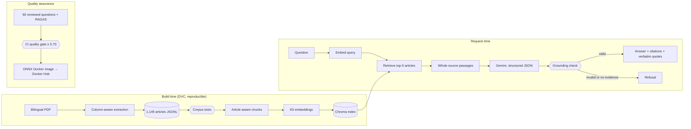

# Arabic Legal Document Q&A

Ask a question in **Arabic or English** about the **Egyptian Civil Code** and get a short
answer that **cites the exact articles** it relies on, with the supporting passages quoted
verbatim from the source. If the retrieved text does not answer the question, the system
says so instead of guessing.

```bash
curl -s localhost:8000/ask -H 'Content-Type: application/json' \
     -d '{"question": "ما تعريف عقد الإيجار؟"}'
```

```json
{
  "answer": "عقد الإيجار هو عقد يلتزم بمقتضاه المؤجر بأن يمكن المستأجر من الانتفاع بشيء معين لمدة معينة مقابل أجر معلوم، وذلك وفقاً للمادة 558 من القانون المدني.",
  "sources": [
    "Egyptian Civil Code, Article 558"
  ],
  "insufficient_evidence": false,
  "evidence": [
    {
      "citation": "Egyptian Civil Code, Article 558",
      "quote": "الإيجار عقد يلتزم المؤجر بمقتضاه أن يمكن المستأجر من الانتفاع بشيء معين مدة معينة لقاء أجر معلوم.",
      "language": "ar"
    }
  ]
}
```

*(A real response, trimmed: it also carries `configuration`, `usage`, `model_version` and, when
tracing is on, `trace_id`.)*

> **This is not legal advice.** Answers are generated from a machine-extracted copy of a
> bilingual edition of the Code. Quotes are verified against that copy, not against the
> official text, and no translation has been certified. See [Limitations](#limitations).

**Contents:** [Quickstart](#quickstart) · [Setup](#setup-from-a-checkout) · [Using the API](#using-the-api) ·
[How it works](#how-it-works) · [Decisions and reasons](#decisions-and-reasons) · [Results](#results) ·
[Operating it](#operating-it) · [Developing](#developing) · [Limitations](#limitations) · [Status](#status)

---

## Quickstart

You need Docker and a Google API key.

**Get a Google API key** at <https://aistudio.google.com/apikey> (a Gemini API key; a Google
account is enough). Answers are generated by Google's API, so each question uses your
quota or billing, and rate limits apply (see [Limitations](#limitations)).

```bash
export GOOGLE_API_KEY=<your key>
docker pull serag11/arabic-legal-document-qa:latest
docker run -d --name legal-qa -p 8000:8000 -e GOOGLE_API_KEY serag11/arabic-legal-document-qa:latest
```

Wait for `curl localhost:8000/health` to answer (the first start loads the embedding model),
then ask a question with the `curl` command above, or open <http://localhost:8000/docs>.

The image is self-contained (about 1.3 GB): code, tokenizer, compact embedding model and the
search index are inside, so it needs no repository, DVC login or model download. For a
reproducible deployment use a `sha-<commit>` tag or the image digest instead of `latest`.

> The published `latest` image was built before streaming (`/ask/stream`), `/metrics` and
> tracing were added. Those need an image built from the `stage7-observability` branch, which
> has not been published yet (see [Status](#status)).

---

## Setup from a checkout

Use this path to change the code, rebuild the data, run evaluations or the monitoring stack.

**Prerequisites:** Linux or macOS, [uv](https://docs.astral.sh/uv/) (installs Python 3.13 for
you), Docker (optional, for containers), a Google API key, and access to the project's DVC
remote (a Google Drive folder) for the source PDF and derived data.

```bash
git clone <this repository> && cd Arabic-Legal-Document-QA
cp .env.example .env            # then put your key in GOOGLE_API_KEY=
uv sync --group evaluation      # app + evaluation tools; add `--group loadtest` for Locust
uv run dvc pull -r storage      # source PDF, corpus, chunks and index (Google Drive login if prompted)
uv run python src/retrieval.py download   # pinned embedding model, once (~1.1 GB, then fully offline)
uv run dvc repro                # re-runs any out-of-date pipeline stage (tests gate each one)
uv run uvicorn src.api:app --port 8000    # or: docker compose up --build -d
```

What the data stages do (`dvc.yaml`): `extract_civil_code` (PDF → structured JSONL) →
`validate_corpus` (tests) → `prepare_retrieval` (chunks) → `index_retrieval` (Chroma) →
`evaluate_retrieval` (metrics). Run `uv run python -m pytest tests/ -q` at any time; it
needs no network and no API key.

`docker compose up --build -d` runs the development image (PyTorch) with the index and your
Hugging Face model cache mounted read-only, so run the `download` step first.

Command-line use without the server:

```bash
uv run python src/rag.py ask "What is a lease?" --filters '{"language":"en","is_repealed":false}'
uv run python src/retrieval.py query "Article 1022"       # retrieval only, no Google call
```

---

## Using the API

| Endpoint | Purpose |
| --- | --- |
| `POST /ask` | Question in, validated cited answer out. |
| `POST /ask/stream` | Same, as server-sent events: `context` → `delta`… → `final` (or `error`). |
| `GET /health` | Service status and indexed document/article counts. |
| `GET /metrics` | Prometheus metrics. |
| `GET /docs` | Interactive OpenAPI page with Arabic, English and repeal-lookup examples. |

Send `question` and optionally `language` (`ar`/`en`; the answer language, defaulting to the
question's script). `filters` are exact-match constraints combined with AND (for example
`{"language": "en", "article_number": 54, "is_repealed": true}`); omit them for normal use.
`filters.language` restricts the *source passages*; the top-level `language` sets the *answer*.
Empty questions return HTTP 422; Google failures return HTTP 502 (never an invented answer).

**Streaming.** Grounding can only be verified once an answer is complete, so `delta` events are
a *draft*. Always replace them with the `final` event, which may turn out to be a refusal.

```bash
curl -sN localhost:8000/ask/stream -H 'Content-Type: application/json' -d '{"question":"What is a lease?"}'
```

**Refusals** have `insufficient_evidence: true`, empty `sources`, and a `reason`:
`no_retrieved_evidence`, `model_reported_insufficient_evidence`, or
`invalid_source_grounding` (the model's answer failed citation/quotation checks and was discarded).

---

## How it works



1. **Extraction** turns the PDF's two parallel columns into one record per article: number,
   citation, hierarchy (book/chapter/section), source page, Arabic text, English text, and
   repeal status. Repealed articles are kept and flagged.
2. **Validation** (tests) checks numbering 1–1149, required text, citations, repeal metadata and
   known regressions before anything is indexed.
3. **Chunking** keeps one chunk per article per language. Only English Article 1143 exceeded the
   model's 512-token limit and was split at source provision boundaries. Final: 2,242 chunks.
4. **Retrieval** embeds the question (`multilingual-e5-base`), finds the nearest chunks in Chroma,
   groups them by article and returns the top five. A question naming one article
   ("Article 1022", "المادة ٥٤") is looked up directly instead.
5. **Generation** sends the question and the retrieved source passages to Gemini and requires a
   structured reply: answer, cited article numbers, and an exact quote per cited article.
6. **Grounding check** rejects any answer that cites an article outside the retrieved context,
   mentions an article it did not declare, lacks evidence, or quotes text that is not a
   character-for-character excerpt of one source passage. A rejected answer becomes a refusal.

Source layout: `src/extract_egyptian_civil_code.py` (extraction) · `src/rag.py` (chunk contracts) ·
`src/retrieval.py` (embedding, index, search) · `src/generation.py` (prompt, Gemini, grounding) ·
`src/api.py` (FastAPI) · `src/deployment.py` (ONNX serving) · `src/experiments.py` (evaluation,
MLflow) · `src/quality_gate.py`, `src/deployment_gate.py` (CI gates) · `src/metrics.py`,
`src/observability.py`, `src/online_eval.py`, `src/drift.py` (monitoring) · `src/reindex.py`
(incremental indexing) · `config/` · `prompts/` · `evaluation/` · `monitoring/` · `deploy/`.

---

## Decisions and reasons

Each choice below is followed by why it was made and what it costs. Where a reason is a
measurement it points to the report; where it is a judgement, it says so.

### Answers come from Google's Gemini API, not a local model

*Why:* the development machine has a 4 GiB GTX 1650 and about 5 GiB of free RAM, so a
capable local generator would be slow and hard to ship. Using the API means no generator
weights to download or distribute, and a 1.3 GB image. The model is a config value (`config/generation.json`, currently
`gemini-3.1-flash-lite`) so it can be swapped. *Cost:* every question sends the question and
retrieved passages to Google, needs a key and quota, and inherits Google's latency and rate
limits (14–26 s per call and frequent HTTP 429/503 in our live runs). A local 4-bit Qwen3-4B was
considered and **not** benchmarked; the expected risks are more grounding failures, slow CPU
generation and a 3 GB+ image, so it was deferred. The key lives only in `.env`/the environment,
never in config, prompts, reports, the image or the registered model.

### Retrieval is local: multilingual E5 + Chroma

*Why:* retrieval needs no key, runs offline after one model download, and keeps passages on
your machine. `intfloat/multilingual-e5-base` was chosen from six candidates as the best fit for
the hardware and for whole legal articles (768 dimensions, 512-token input, trained for
retrieval; `reports/embedding-model-options.md`), and is pinned to an exact revision so the
index is reproducible. *Cost:* it misses some Arabic paraphrases (see Results), and larger
candidate models (e5-large, bge-m3, Qwen3-Embedding) were **not** compared.

### One chunk per article per language, never cut mid-provision

*Why:* a legal answer must cite an article, so the article is the unit of meaning; fixed-size
windows would split provisions and break the link between a passage and its citation. A token
audit found a single oversize passage (English Article 1143), split at verified provision
boundaries. Nothing is truncated to fit the model. *Cost:* uneven chunk sizes; chunk-size
experiments (the usual RAG tuning) were not run because the unit is fixed by the citation need.

### Source text and search text are stored separately

*Why:* Arabic is normalized for matching (letter-variant folding, diacritics), but a legal
quotation must be the original wording. Normalized text is used only for embeddings; every
returned passage and quote comes from the source-faithful field.

### Answers must be provable against the source, otherwise refuse

*Why:* in a legal setting a fluent wrong answer is worse than no answer. The model must return
citations and verbatim quotes, and code (not the model) verifies them; failures become refusals.
*Cost:* some correct answers are discarded when the model quotes loosely. This was observed:
three of six known failures were quotes stitched together with "…", and the prompt now requires
one contiguous excerpt per quote (5 of 6 cases pass after the change; a formal re-evaluation is
pending). Checking quotes proves traceability, not that the answer is *correct*.

### Source quirks are documented, not hidden

Article 558's Arabic body is bold (a naive heading filter dropped it; fixed), a PDF glyph-order
problem (3,501 candidate zero-width alef variants found) was fixed from glyph geometry, not by
global replacement, and
Article 1022 has **no Arabic text in the source** (kept empty and flagged; Arabic answers using
it carry an explicit note). Details: `reports/corpus-extraction.md`.

### DVC for data, a Google Drive remote for sharing

*Why:* the corpus, chunks and index are derived from a PDF through several stages; DVC records
exactly which inputs produced which outputs and re-runs only what changed. The remote lets a
collaborator `dvc pull` instead of re-extracting. *Cost:* Drive authentication is awkward
(OAuth client secrets must stay in `.dvc/config.local`, which is git-ignored), and a clean-checkout
`dvc pull` + `dvc repro` is **not yet verified end to end**.

### Evaluation is fixed, bilingual and human-reviewed

*Why:* quality claims need a stable yardstick. 30 question pairs (60 questions, Arabic and
English) were reviewed by the project owner, with reference excerpts and expected articles, plus
four refusal probes. Metrics: retrieval hit/MRR, citation coverage, refusal accuracy, and RAGAS
faithfulness (automated, judged by the same Gemini family, so an estimate not legal review).
Five retrieval settings were compared in MLflow; **top-k 5** won and is what the service uses.

### A CI gate that goes stale on purpose

`quality_gate` requires coverage-adjusted faithfulness ≥ 0.75 and refuses scores that were
measured on different code, prompts, config, dependencies or data (a fingerprint). *Why:* a
number that no longer describes the system is worse than none. *Cost:* any change to those
files needs a fresh paid evaluation before CI turns green; this is why the Stage 7 work sits on a
branch (see Status). Abstentions count as zero in the adjusted score, so being too cautious is penalized.

### A compact ONNX image, built in CI from a pinned release bundle

*Why:* the image uses FP16-stored, FP32-computed ONNX weights (555 MB instead of 1.11 GB) with no
PyTorch. All 60 evaluated generator contexts came out identical, so existing generation scores
are reused (documented as reuse, not a new RAGAS run). INT8 was smaller but lost two Arabic
retrieval hits (55/56 → 53/56) and was **rejected**. CI downloads a checksum-pinned GitHub Release
bundle rather than authenticating to DVC/Google Drive, which keeps CI free of personal credentials.
Details: `reports/stage6-delivery.md`.

### Streaming sends a draft, then the verified answer

*Why:* users should see progress while a 15–20 s call runs, but grounding needs the whole answer.
So deltas are provisional and `final` is authoritative. *Cost:* a client can briefly display text
that is then replaced by a refusal. Note streaming does not reduce Gemini's wait before the
first token.

### Only retrieval is serialized

The first API version locked the whole request, so one slow Gemini call blocked everyone. In a
50-user test with a simulated 1.5 s provider, the median fell from 27 s to 1.6 s (0.5 → ~13
requests/s) once the lock covered only the shared encoder (`reports/load-test.md`).

### Observability: Langfuse traces, Prometheus/Grafana, Locust

*Why:* a rejected answer used to leave no evidence of *why*. Traces now keep the discarded
candidate and the failing check, which is how the stitched-quote problem was found.
Prometheus tracks outcomes, latency, tokens/cost, drift and sampled faithfulness, with tested
alert rules. *Caveats:* cost is an estimate from third-party price reports; the drift alert
detects off-topic traffic but not "adjacent" legal subjects (use the refusal-rate alert);
the Prometheus/Grafana containers have not been run yet (`reports/monitoring.md`).

### What was deliberately **not** done

- **vLLM / AWQ quantization / BentoML:** they need a self-hosted generator and GPU capacity we
  do not have; FastAPI already serves the API. Documented as out of scope rather than faked.
- **Multi-document answering:** the index can hold several documents (`legal-qa-reindex`) but
  answers stay scoped to the Civil Code; a second real document would need its own reviewed
  question set.
- **Reranker:** planned (aimed at the one known Arabic retrieval miss) but not built yet.

---

## Results

Measured on the fixed 60-question set (`reports/answer-evaluation.md`, `reports/retrieval-baseline.md`),
before the Stage 7 prompt change:

| Measure | Result |
| --- | --- |
| Expected article in the top 5 | 55 / 56 supported questions (Arabic semantic 24/25, English 25/25) |
| Answered with the expected citation | 51 / 56 |
| Answers produced | 52 / 56 supported; all 4 unsupported probes correctly refused |
| Faithfulness (RAGAS) | 0.996 on scored answers; **0.925 coverage-adjusted** (gate ≥ 0.75) |
| Known retrieval miss | Arabic question for Article 1065 (English ranks it first) |
| Latency (retrieval / our overhead) | 0.04–0.07 s / about 0.1 s at 50 users; Gemini adds 14–26 s |

---

## Operating it

| Task | How |
| --- | --- |
| Trace every request | Set `LANGFUSE_*` in `.env`; traces carry `ask → retrieval → generation → grounding` spans. |
| Metrics, dashboard, alerts | `docker compose -f compose.yaml -f compose.monitoring.yaml up` (set `GRAFANA_ADMIN_PASSWORD`); see `reports/monitoring.md`. |
| Sample faithfulness live | `ONLINE_FAITHFULNESS_SAMPLE_RATE=0.05` (needs `--group evaluation`; costs quota). |
| Load test | `uv sync --group loadtest`; `LANGFUSE_PUBLIC_KEY= uv run uvicorn src.loadtest_app:app --port 8001`; `uv run locust -f loadtest/locustfile.py --headless -H http://localhost:8001 -u 50 -r 10 -t 90s`. |
| Add or update a document | `uv run legal-qa-reindex --index <dir> --corpus my-law=my_law.jsonl` (`--dry-run` first; embeds only changed chunks; restart the service to load it). Works on a copy; the DVC index is never a default. |
| Roll out a new image | `deploy/canary/README.md` (stages, promotion gates, rollback; configuration validated but not yet run). |
| Rebuild the drift baseline | `uv run python -m src.drift` after changing the embedding model. |

Configuration reference — `.env` (see `.env.example`): `GOOGLE_API_KEY` (required);
`LANGFUSE_PUBLIC_KEY/SECRET_KEY/BASE_URL`; `ONLINE_FAITHFULNESS_SAMPLE_RATE`;
`GRAFANA_ADMIN_PASSWORD`. Files: `config/retrieval.json` (model, chunking),
`config/generation.json` (model, top-k, budgets, prices), `config/experiments.json` (judge,
variants), `prompts/answer_v1.txt`. Set `LEGAL_QA_ROOT` when running outside the checkout.

---

## Developing

```bash
uv run python -m pytest tests/ -q     # ~110 offline tests, no key or network
uvx ruff==0.14.0 check src tests
uv run python src/evaluate_generation.py            # live six-case smoke run (uses quota)
uv run --group evaluation python -m src.experiments prepare|run|register   # full paid evaluation + MLflow
python -m src.quality_gate && python -m src.deployment_gate                # offline CI gates
```

GitHub Actions (`.github/workflows/delivery.yml`) runs the gates, lint, tests, builds the ONNX
image, smoke-tests it offline, and on `main` publishes it to Docker Hub and verifies an anonymous
pull. Deeper notes: `tests/README.md`, `reports/`, and the roadmap in `PLAN.md`.

---

## Limitations

- **Not authoritative:** extracted from a PDF and not audited article by article. The planned
  manual review of 20 sampled crops and all flagged records is still open.
- **One corpus** is answered; one known Arabic retrieval miss (Article 1065); the evaluation has
  one seed article per question and is not exhaustive.
- **Faithfulness scores are automated** (same model family as the generator) and the sample is small.
- **Provider dependence:** Google's latency, quota and outages directly affect users; 429/503 are
  surfaced as HTTP 502 with no automatic retry.
- **Wrong-rule answers are possible** even when every quote is verbatim (a past case cited the
  employment article for a contract-for-work question).
- Questions and passages go to Google (and to Langfuse when tracing is on).

---

## Status

- **Main** has the verified baseline: corpus, retrieval, grounded generation, API, ONNX image,
  CI and public Docker Hub delivery.
- **Branch `stage7-observability`** adds tracing, streaming, metrics/alerts, load testing, the
  prompt fix, the canary guide and re-indexing. 112 offline tests pass; the quality and
  deployment gates are intentionally **stale** until the full 60-question evaluation is re-run
  once Stage 7 is complete, so it should not be merged or published before that.
- **Open:** clean-checkout `dvc pull` + `dvc repro` check, manual corpus review, a reranker,
  running the monitoring and canary containers, and the final re-evaluation. See `PLAN.md`.
